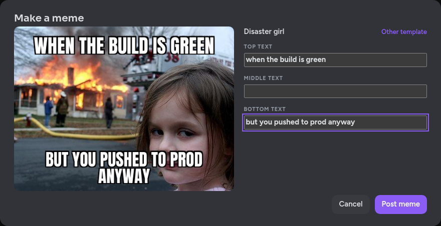

# Antimatter Memes Plugin

Make memes in [Antimatter](https://github.com/antimatterchat/antimatter) from the most popular text-on-image
templates: Disaster Girl, "X, X everywhere", "I don't always X, but when I do", Drake, the distracted
boyfriend, "Wait, it's all X? Always has been", Anakin and Padmé's "…, right?", Success Kid, "This is fine"
and fifty more.



## Using it

- **From the emoji picker.** The message box's emoji picker has a **Memes** tab, after GIFs, Stickers and Emoji
  in the Fusion web UI. It shows the templates, searchable by name, and the last memes you made. Pick one to
  open the meme dialog.
- **In the dialog**, write the captions across the image at its **top**, **middle** and **bottom**, as on
  imgflip. Templates with boxes of their own, like Drake's two panels, also take text in those. The preview is
  drawn by the server, exactly as the meme will be posted. **Post meme** posts it as an image in the channel or
  thread you were writing in.
- **With `/meme`.** A bare `/meme` opens the dialog on the gallery. `/meme everywhere "memes." "memes everywhere"`
  or `/meme memes. memes everywhere` posts a meme right away; `/meme help` lists the templates.

Memes are posted as you, with the same checks as your own messages: you need to be allowed to post in the
channel, and archived channels take no memes.

## Installation

1. Download the latest release from https://github.com/antimatterchat/antimatter-plugin-memes/releases/latest.
2. Upload it in **System Console > Plugins > Plugin Management**, then enable it.

## Development

```sh
make dist          # builds the server for every platform, the web app, and the bundle in dist/
make test          # Go and web app tests
make check-style   # golangci-lint, eslint and the type checker
```

Set `MM_SERVICESETTINGS_ENABLEDEVELOPER=1` to build the server for your platform only.

The templates live in `server/memelibrary/assets`: an image in `images/`, and in `metadata/` a YAML file with
its title, aliases, the patterns `/meme` recognizes, and its own boxes (`slots`) when captions across the
image don't fit it. The fonts are in `fonts/`; everything is built into the plugin with `go:embed`.

To preview a meme from the terminal:

```sh
go run ./server -out demo.jpg 'memes. memes everywhere' && xdg-open demo.jpg
```

## Feedback and support

Found a bug in the Memes plugin, or missing a feature? Please [open an
issue](https://github.com/AntimatterChat/community/issues/new/choose) in the [Antimatter community
repository](https://github.com/AntimatterChat/community), where the feedback for every part of
Antimatter is gathered. Questions and ideas are welcome in its
[Discussions](https://github.com/AntimatterChat/community/discussions). Please report security
problems privately, as explained in the [security
policy](https://github.com/AntimatterChat/.github/blob/main/SECURITY.md).

## Thanks

This plugin started as [mattermost-plugin-memes](https://github.com/mattermost/mattermost-plugin-memes), a
community plugin of the Mattermost ecosystem. Many thanks to the Mattermost community, and to everyone who
contributed to it over the years, for the meme library, the renderer and the `/meme` command this plugin is built
on.

## License

Apache License 2.0, see [LICENSE](LICENSE).
